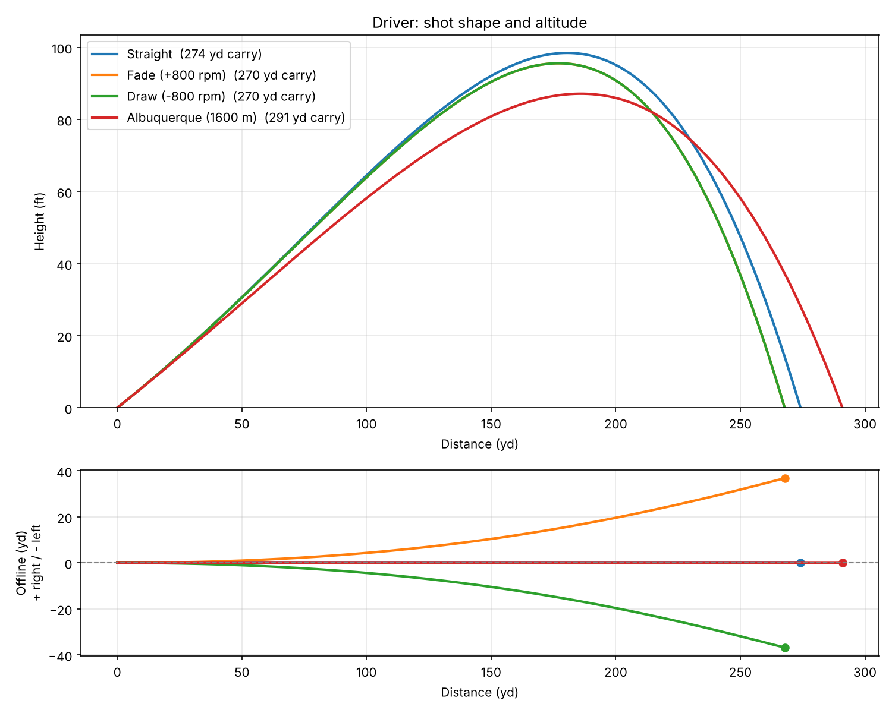
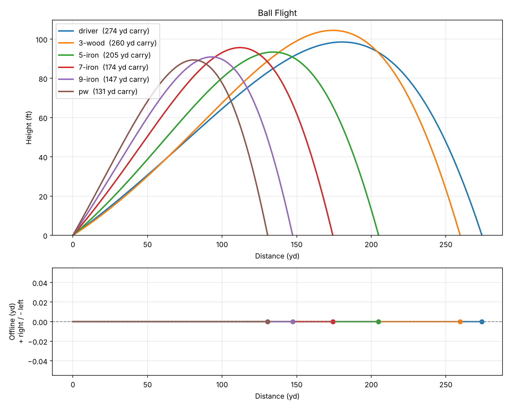

# Golf Ball Flight Simulator

A physics-based golf ball flight simulator in Python. Give it launch monitor numbers (ball speed, launch angle, spin) and it computes the full 3D trajectory, carry distance, apex height, curve, and landing angle, accounting for drag, Magnus lift, spin decay, wind, and altitude.

This is the first step toward building my own golf simulator.



## Features

- **3D trajectory** solved with a 4th-order Runge-Kutta (RK4) integrator
- **Aerodynamics:** spin-dependent drag and lift coefficients, with spin decaying during flight
- **Shot shape:** side spin and start direction produce draws, fades, hooks, and slices
- **Conditions:** headwind, tailwind, and crosswind; air density from altitude and temperature
- **Club presets** using TrackMan PGA Tour average launch conditions
- **Validated:** carry distances land within 8% of tour averages for every club (see tests)
- **CLI and plots:** side-view and top-down trajectory charts

## Validation

The drag and lift models were fit to TrackMan PGA Tour averages, then checked across all six preset clubs.

| Club | Simulated carry | Tour average | Apex (sim) | Landing angle (sim) |
|---|---|---|---|---|
| Driver | 274 yd | 282 yd | 99 ft | 38° |
| 3-wood | 260 yd | 249 yd | 104 ft | 41° |
| 5-iron | 205 yd | 194 yd | 93 ft | 43° |
| 7-iron | 174 yd | 176 yd | 96 ft | 47° |
| 9-iron | 147 yd | 152 yd | 91 ft | 49° |
| PW | 131 yd | 136 yd | 89 ft | 51° |

At Albuquerque's elevation (about 1,600 m), the same driver carries **291 yards**, about 17 yards farther, because thinner air means less drag.



## Getting started

```bash
git clone https://github.com/jerrydavis24/golf-ball-flight-sim.git
cd golf-ball-flight-sim
pip install -r requirements.txt
```

### Examples

```bash
# Tour-average driver
python -m golfsim --club driver

# Custom shot: 160 mph, 12 degrees, 2800 rpm, with a fade
python -m golfsim --speed 160 --launch 12 --spin 2800 --side-spin 600 --plot

# 7-iron at altitude into a 10 mph headwind
python -m golfsim --club 7-iron --altitude 1600 --wind 10 --wind-from 0

# Compare every club and save the chart
python -m golfsim --compare-clubs --save comparison.png
```

### Use it as a library

```python
from golfsim import Shot, Conditions, simulate

result = simulate(Shot(ball_speed_mph=171, launch_angle_deg=10.4, back_spin_rpm=2545),
                  Conditions(altitude_m=1600, wind_speed_mph=10, wind_from_deg=180))
print(result.summary)
```

## How it works

The ball is treated as a point mass with three forces acting on it:

- **Gravity:** constant, straight down
- **Drag:** `F = ½ ρ A Cd v²`, opposite the ball's velocity relative to the air
- **Magnus lift:** `F = ½ ρ A Cl v²`, perpendicular to both the velocity and the spin axis. Backspin makes the ball climb; side spin makes it curve.

Both coefficients depend on the **spin factor** `S = r·ω / v`, so a ball behaves differently as it slows down and its spin decays. Lift rises quickly at low spin factors and then levels off, matching the shape of published wind-tunnel data.

At each 5 ms time step, the simulator uses RK4 to update position and velocity, then interpolates the exact moment the ball returns to the ground. A test confirms results stay stable as the time step shrinks.

Coordinates: `x` is downrange, `y` is up, and `z` is right of the target line.

## Project structure

```
golfsim/
  physics.py    # forces, aerodynamic model, RK4 integrator
  clubs.py      # tour-average club presets
  plotting.py   # side and top-down trajectory plots
  __main__.py   # command-line interface
tests/
  test_physics.py
```

## Tests

```bash
python -m unittest discover tests -v
```

Tests cover validation against tour data, shot shape direction, wind and altitude effects, landing at ground level, and numerical stability. They run automatically on every push through GitHub Actions.

## Roadmap

- [ ] Bounce and roll after landing, based on landing angle and turf firmness
- [ ] Spin axis tilt input (how launch monitors report curve)
- [ ] Interactive 3D view in the browser
- [ ] Read real launch monitor data from a CSV
- [ ] Sensor input from an IMU on a Raspberry Pi to estimate club and ball data
- [ ] A full simulator with a target green and scoring

## Limitations

This is a simplified model. It treats the ball as a point mass, uses fitted coefficients rather than measured wind-tunnel curves for a specific ball, and assumes the spin axis stays fixed during flight. Results are realistic for typical shots but aren't a substitute for a launch monitor.

## License

MIT
